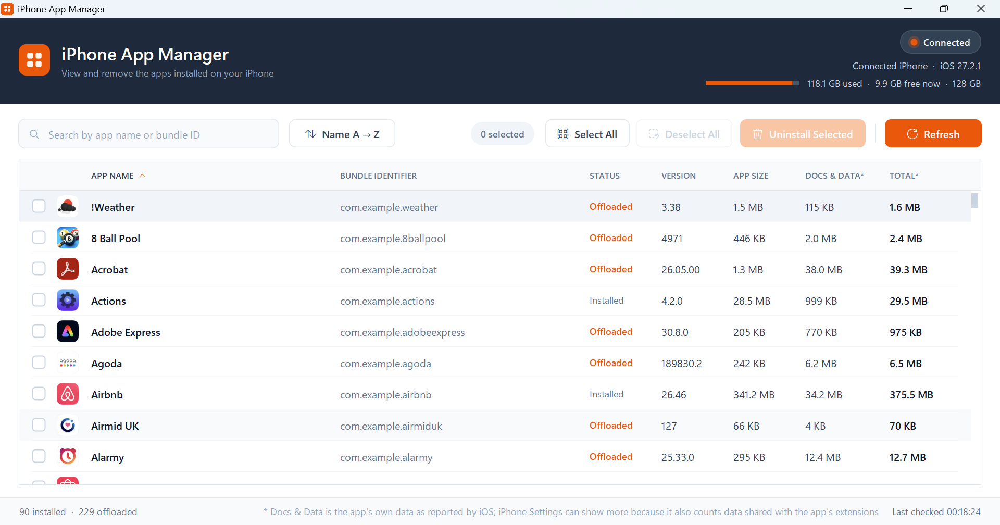
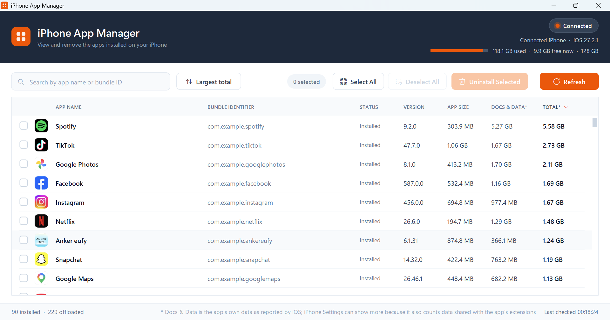
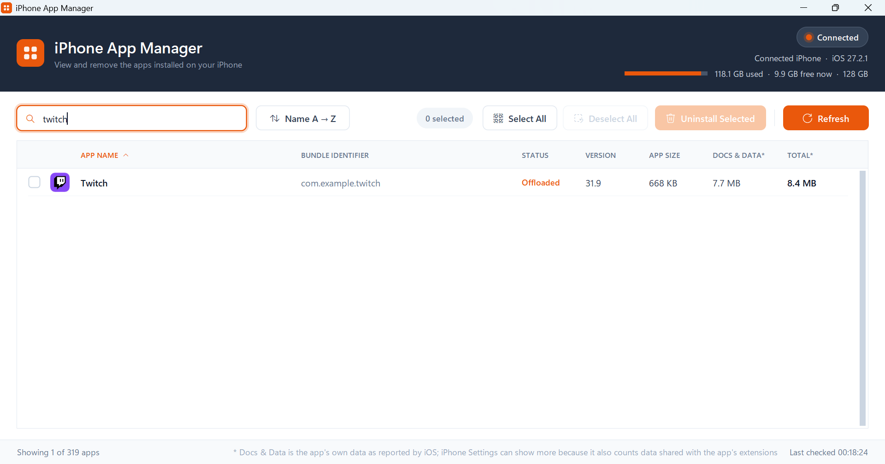
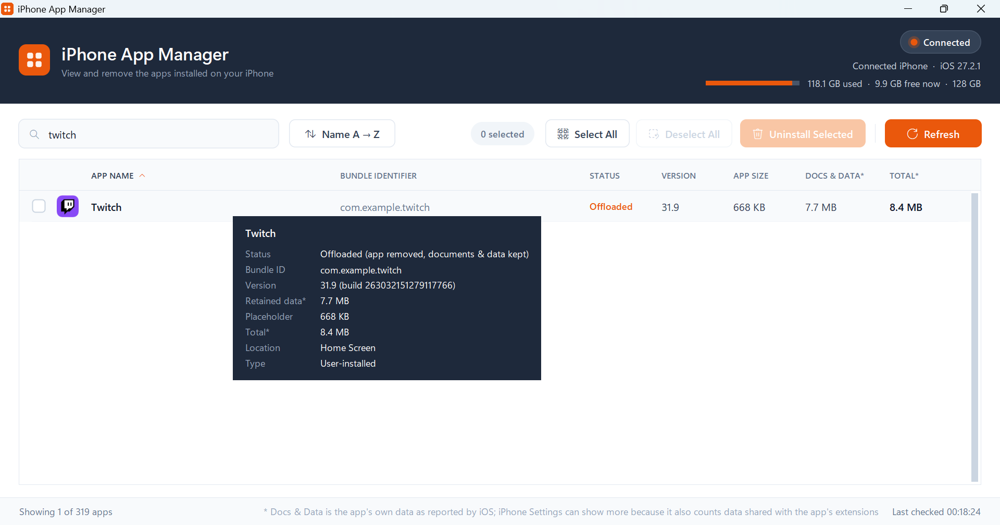
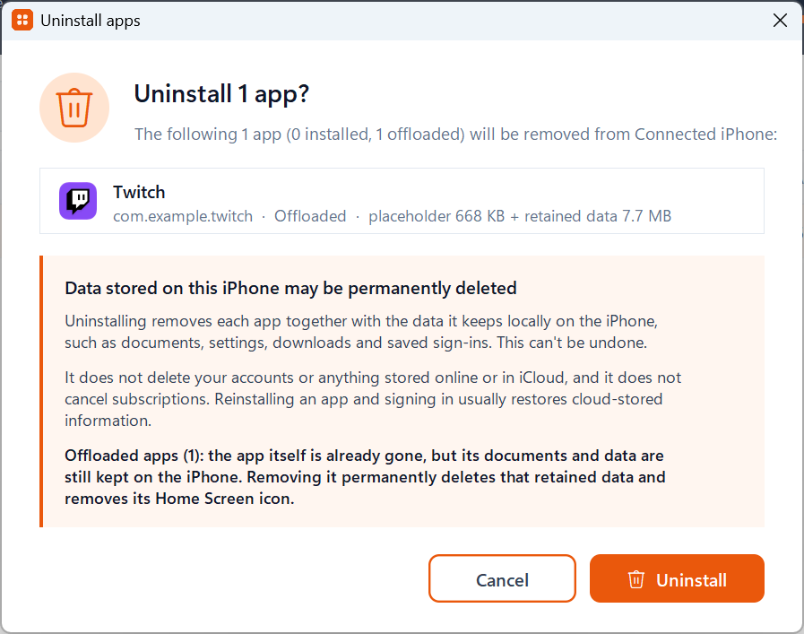
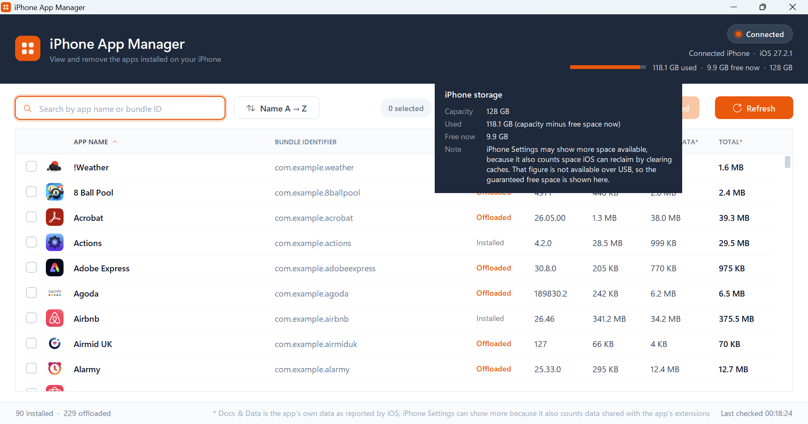

# iPhone App Manager

**Version 1.0.2** · Windows desktop app

A free Windows app for viewing and removing the apps on an iPhone connected by USB or over Wi-Fi. See your installed and offloaded apps with their real icons and storage use, tick the ones you no longer want, and remove them in one go, with a confirmation step and a check afterwards that each app is really gone.

> This is an independent project. It is not made by, or affiliated with, Apple Inc. "iPhone" is a trademark of Apple Inc.

> ## ⚠️ Important: removing apps is permanent
>
> - **Uninstalling an app permanently removes it from your iPhone**, together with the data it keeps on the phone (documents, settings, downloads, saved sign-ins).
> - **Removing an offloaded app also discards its retained app data.** An offloaded app has already had the app itself removed by iOS, but its data is still kept. Removing it deletes that data for good.
> - **These actions cannot be undone through iPhone App Manager.** You would have to reinstall the app yourself (for example from the App Store).
> - **Check your selection carefully** before you confirm. Only the **Uninstall** button in the confirmation window starts a removal, and its **Cancel** button has the keyboard focus by default, so pressing Enter cancels.
>
> Accounts and anything stored online or in iCloud are not deleted, and subscriptions are not cancelled.

## Features

- Lists the apps on your iPhone, including **offloaded** apps (apps whose data is kept but whose app is removed).
- Shows the real app icons taken from the iPhone.
- Shows storage information for the iPhone and per-app sizes where iOS reports them.
- Search, sort, and tick several apps at once (checkbox, double-click, or Space).
- **Bulk uninstall with safety checks:**
  - You always get a confirmation dialog listing exactly what will be removed.
  - Apple's own apps (`com.apple.*`) are protected and cannot be removed.
  - Apps are removed one at a time, and the app then re-reads the iPhone to verify each removal. Anything that did not really go is reported as failed, not as a success.
  - If the iPhone disconnects, the batch stops.
- **USB or Wi-Fi.** USB is the default. Wi-Fi is a second connection choice in the window's header; once it is set up (see [Connecting over Wi-Fi](#connecting-over-wi-fi)) everything works the same way over either. **Wi-Fi support is new: it has been tried on only one real iPhone and one home network** (see [Known limitations](#known-limitations)). The wireless option uses your Wi-Fi network, **not Bluetooth**: an iPhone does not offer app management over Bluetooth, so Bluetooth is not supported.
- If more than one iPhone is available, the app asks you which one to use. It never picks one for you, and it never switches iPhone or connection on its own.
- Clear messages for common problems (no iPhone, iPhone locked, not trusted, Wi-Fi sync not turned on, iPhone not on the network).
- The app talks to your iPhone through Apple's device service and the bundled libimobiledevice tools, over USB or over your local Wi-Fi network. It does not use the internet and sends nothing anywhere else. The only network connection it opens itself is to Apple's device service on your own PC (the loopback address, `127.0.0.1`), to ask which iPhones it can reach.

Keyboard shortcuts: **F5** refresh · **Ctrl+F** search · **Esc** (in search) clear search · **Space** toggle highlighted rows.

## Screenshots

The device name and app identifiers in these images have been replaced with neutral examples. See [`Screenshots/README.md`](Screenshots/README.md) for details.

### Main window


*The connected iPhone, its storage bar, and every app with its status, version and sizes.*

### Sort by storage use


*Sort by **Largest total** to find the apps taking the most space.*

### Offloaded apps and retained data


*Offloaded apps are marked **Offloaded**. The columns show the small placeholder left behind and the data iOS kept.*

### App details


*Rest the pointer on an app's name to see its details.*

### Uninstall confirmation


*Nothing is removed until you click **Uninstall** in this window. **Cancel** closes it without removing anything.*

### iPhone storage overview


*Rest the pointer on the storage bar to see capacity, used and free space.*

## System requirements

- Windows 10 or 11, 64-bit. (The program has been tested on Windows 11; see [Known limitations](#known-limitations).)
- The **Microsoft Visual C++ Redistributable for Visual Studio 2015-2022 (x64)**, version **14.43.34808 or newer**. It is **not included** with iPhone App Manager. See [Microsoft Visual C++ Redistributable](#microsoft-visual-c-redistributable-x64) below.
- Apple's **Apple Devices** app from the Microsoft Store. It provides the USB driver and service that let Windows talk to an iPhone. It is also where Wi-Fi sync is turned on for wireless use.
- An iPhone and a USB cable. For Wi-Fi you need the cable once, for the first set-up (below), and the iPhone and the PC on the same Wi-Fi network.

You do **not** need Python or any developer tools to use the installer or portable version.

### Microsoft Visual C++ Redistributable (x64)

iPhone App Manager needs Microsoft's Visual C++ Redistributable (x64), which is **not included** in the installer or the portable ZIP. Many PCs already have it, because other programs install it. If it is missing or too old:

- The installer tells you and lets you choose whether to continue, but the program **will not start** until the redistributable is installed.
- The portable version has no such check. If the program does not start and shows **"Failed to load Python DLL"**, the redistributable is probably missing.

Download the latest **x64** version from Microsoft's official page: <https://learn.microsoft.com/en-us/cpp/windows/latest-supported-vc-redist>. Installing it normally needs **administrator rights**. A newer version is fine, and it replaces an older one.

## Installation

1. Install the **Microsoft Visual C++ Redistributable (x64)** (see above) and **Apple Devices** from the Microsoft Store if you do not already have them.
2. Download `iPhone App Manager Setup 1.0.2.exe` from the project's **Releases** page.
3. Run it. It installs just for you (no administrator prompt) into `%LOCALAPPDATA%\Programs\iPhone App Manager`, adds a Start Menu entry, and optionally a Desktop shortcut. If the Visual C++ Redistributable is missing or too old, it warns you first.
4. Start **iPhone App Manager** from the Start Menu.

## Connecting your iPhone

Plug the iPhone in by USB, unlock it, and tap **Trust** if it asks "Trust This Computer?". Step-by-step instructions, and what to do if the iPhone isn't found, are in [How to use](#how-to-use). To manage it without a cable, see the next section.

## Connecting over Wi-Fi

Wireless management uses **Wi-Fi, not Bluetooth**. Bluetooth cannot be used: the iPhone does not offer app management over Bluetooth.

**One-time set-up (needs the USB cable):**

1. Connect the iPhone to the PC with a USB cable, unlock it, and tap **Trust** if asked.
2. Open **Apple Devices**.
3. Select the iPhone in the sidebar.
4. Choose **General**.
5. Tick **Show this iPhone when on Wi-Fi**.
6. Click **Apply**.
7. Make sure the iPhone and the PC are on the **same Wi-Fi network**. You can then unplug the cable.

   On the one iPhone tried, steps 5 and 6 did not take effect (the box un-ticked itself); see [Known limitations](#known-limitations).

iPhone App Manager does not bypass Apple's pairing or trust requirements: the Wi-Fi set-up and the trust prompt must be done in Apple Devices, over USB, first.

**Using it:**

- The window's header has a **USB | Wi-Fi** switch next to the connection status. **USB is the default**, and the chosen connection is highlighted in orange.
- Choose **Wi-Fi**. The app looks for iPhones that Apple's service reports as reachable over the network. The status then reads, for example, "Test iPhone · iOS 26.1 · Wi-Fi".
- If more than one iPhone is available, a window asks you to choose one. Nothing is read from or changed on any iPhone until you do. The choice is remembered until you switch connection.
- Listing apps, icons and storage worked over Wi-Fi on the one iPhone tried. Removing one app or several, and the check afterwards that each app is really gone, use the same code over Wi-Fi as over USB, always on the iPhone and connection you chose (the check after a removal uses the same iPhone and the same connection as the removal), but **removing apps over Wi-Fi has not been tested on a real iPhone**.
- The switch is locked while the app is loading or removing apps. Switching connection clears your ticks, because they belong to the iPhone that was showing.

**Network requirements:** the iPhone and the PC must be on the same Wi-Fi network (the same local network, not a guest or isolated network), and the iPhone should be awake and unlocked. The iPhone may only be visible over Wi-Fi while it is powered, awake or charging. Some routers and firewalls block devices from seeing each other, and that stops Wi-Fi from working.

The app never falls back from Wi-Fi to USB, or from USB to Wi-Fi, by itself. If the iPhone drops off the Wi-Fi in the middle of removing apps, the removal stops, the remaining apps are reported as not attempted, and nothing is sent over USB instead.

## How to use

### 1. Connect your iPhone

1. Plug the iPhone into the PC with a USB cable, and unlock it.
2. If the iPhone asks **"Trust This Computer?"**, tap **Trust** and enter your passcode.
3. Start iPhone App Manager, or click **Refresh** (or press **F5**) if it is already open. **USB** is selected by default; to use Wi-Fi instead, see [Connecting over Wi-Fi](#connecting-over-wi-fi).

The app shows "Reading apps from your iPhone…" while it loads the list. Keep the iPhone connected and unlocked; this usually takes a few seconds (a little longer over Wi-Fi).

### 2. Read the app list

Installed and offloaded apps appear together in **one list**. Each row shows the app icon, its name, its bundle identifier (a technical ID such as `com.example.app`), a status and sizes.

- Offloaded apps are marked **Offloaded** in the list.
- A summary line shows how many apps are installed and offloaded, for example "12 installed · 3 offloaded". While the app is still working, it says so ("checking for offloaded apps…", "Calculating app sizes…").
- The columns show **App size**, **Docs & Data** and **Total**. For an offloaded app, the sizes are the small placeholder left behind plus the data that iOS kept.
- Rest the mouse pointer on an app's name for a moment to see a details card (status, bundle ID, version and, where iOS reports them, sizes and other information).
- The sizes come from iOS, and the "Docs & Data" figure can be smaller than the one in the iPhone's Settings. A size can show "Calculating…" or "Not available" if iOS has not reported a figure.
- Real icons are loaded in the background. Until they arrive, placeholder icons are shown.

### 3. Search and sort

- Type in the search box (or press **Ctrl+F**) to filter by app name or bundle ID. The summary then reads "Showing X of Y apps". Press **Esc** in the box, or click **Clear search**, to clear it.
- Use the **Sort** button, or click a column heading (App name, Status, App size, Docs & Data, Total), to change the order. Options include name A to Z, name Z to A, and largest or smallest sizes. The first click on **Status** puts Offloaded apps first, then Installed apps; each further click reverses the two groups. Apps stay in name order (A to Z) within each group, and an arrow beside the heading shows the direction.

### 4. Select apps

- Click an app's checkbox or icon, or double-click its row, to tick it.
- Click a row to highlight it (Ctrl+click or Shift+click for several rows, or use the arrow keys), then press **Space** to tick or untick all highlighted rows.
- **Select All** (or **Ctrl+A** in the list) ticks every app currently shown. If you have searched, only the matching apps are ticked.
- **Deselect All** unticks everything, including selected apps hidden by a search.
- The **selected** counter shows how many apps are ticked. Click it to open a review list of the selected apps.

### 5. Remove apps

1. Tick the apps you want to remove. You can mix installed and offloaded apps.
2. Click **Uninstall Selected**. It is greyed out while the app is loading or when no removable app is selected.
3. A **confirmation window** lists the apps that will be removed from your iPhone (with how many are installed and how many offloaded) and warns that data on the iPhone may be permanently deleted. If you selected offloaded apps, it adds a separate notice that their retained data will be deleted.
4. Apps that can't be removed are skipped, and the window says how many and why. Apple's own apps (`com.apple.*`) are protected and are never removed.
5. Read the list carefully, then click **Uninstall** to go ahead, or **Cancel** to stop. Nothing is removed unless you click **Uninstall** in this window.

### 6. Progress and verification

- A progress window removes the apps **one at a time** and shows which one is being removed. You can't close this window while removal is running, and **Refresh** is turned off.
- If you try to close the main window during removal, the app asks you to confirm. The app being removed may still finish, but the remaining apps will not be removed.
- When the removals finish, the app **reloads the list from the iPhone and checks each result** against the installed apps, the offloaded apps and the Home Screen. An app that is reported as removed but is still on the iPhone is not counted as removed.
- The final summary shows how many were **removed**, **failed**, **not attempted**, **skipped** or **not verified**. Each app's row shows its own result and, if something went wrong, the reason.
- Apps that were not confirmed as removed stay ticked. **Nothing is retried automatically.**

### If something goes wrong

| What you see | What to do |
|---|---|
| **The program does not start** and shows "Failed to load Python DLL" | Install the latest x64 [Microsoft Visual C++ Redistributable](https://learn.microsoft.com/en-us/cpp/windows/latest-supported-vc-redist) (it may need administrator rights), then start the program again. |
| **No iPhone connected** | Connect the iPhone with a USB cable, unlock it, then click **Refresh**. If it is already plugged in, check that the Apple Devices app can see it. |
| **iPhone doesn't trust this computer** | Unlock the iPhone. When "Trust This Computer?" appears, tap **Trust** and enter your passcode, then click **Refresh**. |
| **iPhone is locked** | Unlock the iPhone with your passcode, then click **Refresh**. |
| **iPhone isn't responding** | Unplug the iPhone, plug it back in, unlock it, then click **Refresh**. |
| **Wi-Fi sync isn't turned on for this iPhone** (Wi-Fi) | Connect the iPhone by USB, open Apple Devices, select the iPhone, choose **General**, tick **Show this iPhone when on Wi-Fi**, click **Apply**, then unplug and click **Refresh**. |
| **iPhone not available over Wi-Fi** (Wi-Fi) | Check that Wi-Fi sync was set up (above), that the iPhone is awake, unlocked and on the same Wi-Fi network as the PC, then click **Refresh**. If it still isn't found, switch to USB. |
| **iPhone isn't set up for this PC** (Wi-Fi) | Trust can only be given over USB. Connect by USB, tap **Trust**, make sure Wi-Fi sync is on, switch back to Wi-Fi and click **Refresh**. |
| **Apple device service unavailable** | Install or repair the Apple Devices app from the Microsoft Store, make sure it is running, then click **Refresh**. |
| **The iPhone's installation service is unavailable** | Unlock the iPhone and keep it awake, then click **Refresh**. If it keeps happening, reconnect or restart the iPhone. |
| **Choose an iPhone** | More than one iPhone is available. Pick the one you want in the window that opens (or click **Choose iPhone…**). |

These screens have a **Try again** button.

**If the iPhone disconnects, locks, or stops trusting the computer during a removal**, the app stops. The app that was being removed is reported as failed, and the remaining apps are marked **Not attempted**. Nothing further is removed. Reconnect and unlock the iPhone, click **Refresh**, and check the list before trying again. If the list can't be refreshed after a removal, the app says the results could not be double-checked.

## Uninstalling the application

Open **Settings > Apps > Installed apps**, find **iPhone App Manager**, and choose **Uninstall**. The app stores no settings or data files of its own. Removing it does not affect your iPhone or the apps on it.

Apple Devices is separate software and is removed separately if you no longer want it.

## Portable version

The portable version runs without being installed. It will be offered as a ZIP file on the project's **Releases** page once it is published.

1. Install the **Apple Devices** app from the Microsoft Store if you have not already. Apple Devices and its USB drivers are **required** for the portable version too. Also make sure the **Microsoft Visual C++ Redistributable (x64)** is installed (see [above](#microsoft-visual-c-redistributable-x64)); the portable version does not check for it.
2. Download the portable ZIP.
3. Right-click the ZIP and choose **Extract All…**, then pick a folder (for example, one inside your Documents). Don't run the program from inside the ZIP.
4. Open the extracted `iPhone App Manager` folder and double-click `iPhone App Manager.exe`. Keep the whole folder together: the `_internal` and `tools` folders are required.
5. Connect and unlock your iPhone and follow [How to use](#how-to-use).

Python and MSYS2 are **not** needed to run the packaged application. To remove the portable version, close the program and delete the folder.

## Known limitations

- Windows only. Not tested on other operating systems.
- Tested on Windows 11. **Windows 10 has not been tested.**
- Needs the Microsoft Visual C++ Redistributable (x64), which is not included, and the Apple Devices app (or an equivalent Apple USB driver) to be installed.
- **USB is the most tested connection. Wi-Fi support is new and has been tried on only one real iPhone (iOS 27.2.1) and one home network.** On that iPhone the Wi-Fi device list, the app list, the storage figures and the app icons loaded over Wi-Fi, with the same results as over USB. The same read-only checks were repeated with the iPhone unplugged (only a Network entry was listed, no USB entry), and the author then confirmed in the installed 1.0.2 app that it connected over Wi-Fi and loaded the app list and storage. Installing and removing apps over Wi-Fi has **not** been tested on a real iPhone, and other iPhones, routers and iOS versions may behave differently.
- Wi-Fi needs one-time set-up over USB in Apple Devices (**Show this iPhone when on Wi-Fi**), the iPhone and PC on the same network, and the iPhone awake. If Apple's service does not list the iPhone over the network, the app cannot reach it wirelessly. On the one iPhone tried, ticking that box and clicking Apply in Apple Devices did **not** switch wireless sync on (the box un-ticked itself); Wi-Fi worked only after the setting was written to the iPhone directly with a developer tool, which this app does not do. So Wi-Fi may not be available to you even if the app is working correctly.
- When Wi-Fi is not available, the app says "Wi-Fi sync isn't turned on" only if the iPhone, plugged in by USB, explicitly reports that it is off. Some iPhones don't report this setting at all (one tested iPhone did not, even with the box ticked), so you will often see the general "not available over Wi-Fi" message instead, which lists the possible reasons. If the **Show this iPhone when on Wi-Fi** box un-ticks itself after you click Apply, Wi-Fi sync did not turn on.
- **Apple's device service sometimes stops listing the iPhone over Wi-Fi.** On the test PC the list went empty several times, between about 17 and 50 minutes after it had last recovered, even though the iPhone was awake, reachable and still advertising its wireless-sync service. The app then says "iPhone not available over Wi-Fi" (the same message as when Wi-Fi sync is off). Closing and reopening Apple Devices did not fix it. Ending Apple's `AppleMobileDeviceProcess` in Task Manager did: Apple restarts it by itself within about 15 seconds and the iPhone was listed again. The cause is not known and is outside this app.
- Locking the iPhone's screen can make it disappear from the list for a while (it dropped out within seconds of the phone going to sleep and came back when it woke). Keep the iPhone awake while you use Wi-Fi.
- Bluetooth is not supported (the iPhone does not offer app management over Bluetooth).
- When several iPhones are available the app asks you to choose; this has been tested with simulated devices only, not with two real iPhones at once.
- Apple's built-in apps cannot be removed with this tool.
- Per-app storage sizes are only shown when iOS reports them, and iOS can take a few seconds to calculate them; some apps may show "Not available".
- Removing an app removes it from the iPhone as iOS would; this cannot be undone from this app. Data stored only on the iPhone may be lost.
- Tested with a limited set of iPhone and iOS versions. Other versions are not guaranteed to work, and future iOS releases may change behaviour.

## For developers

### Running from source

Requirements: Windows 10/11, Python 3.12 (with Tkinter), the Apple Devices app, and MSYS2 UCRT64 with `libimobiledevice` and `ideviceinstaller` installed in `C:\msys64\ucrt64\bin`. No extra Python packages are needed.

When run from source the app uses MSYS2's `libimobiledevice`, which is still version 1.3.0 and **cannot connect to a Wi-Fi device on Windows** (its network-address code only understands the BSD layout, and fails with `Mux error (-8)`). USB works. The packaged release bundles libimobiledevice 1.4.0, which fixes this (see "Building the release"), so use the packaged build for Wi-Fi. Don't overwrite the files in MSYS2's folder with the 1.4.0 ones: MSYS2's package manager owns them and will restore 1.3.0 on its next update.

```
py -3.12 main.py          (or double-click launch.bat)
```

### Tests

No iPhone is needed, and uninstalls are always mocked.

```
py -3.12 -m unittest discover -s tests -v
```

The packaging tests also check the built release when `dist\iPhone App Manager` and the installer exist, and are skipped otherwise.

### Building the release

PyInstaller is installed only in a separate build environment:

```
py -3.12 -m venv .venv-build
.venv-build\Scripts\python.exe -m pip install pyinstaller
.venv-build\Scripts\python.exe packaging\build.py
```

Add `--installer` to also build the installer (requires Inno Setup 6), or `--installer-only` to wrap an existing portable folder. `packaging\build.py` generates the icon, runs PyInstaller (from `packaging\iphone_app_manager.spec`, in a cleaned environment) and leaves Microsoft's runtime files out of the release (the app-local UCRT and `VCRUNTIME140.dll`; see `packaging\runtime_policy.py`) because the app relies on Windows' own UCRT and on the separately installed Visual C++ Redistributable, copies the libimobiledevice tools and DLLs into `tools\libimobiledevice`, and writes licence notices to `licenses\`. Built files go to `dist\` and are not committed.

Two of the bundled files, `libimobiledevice-1.0.dll` and `ideviceinfo.exe`, are not taken from MSYS2: MSYS2 still has libimobiledevice 1.3.0, which cannot use a Wi-Fi device on Windows. They are built from the unmodified upstream 1.4.0 release tarball by `packaging\build_libimobiledevice.sh` (run in an MSYS2 UCRT64 shell; it verifies the tarballs' SHA-256 values and applies no patches), and the resulting files are kept, with their SHA-256 pins in `packaging\third_party.py`, in `packaging\third-party-binaries\libimobiledevice-1.4.0`. libimobiledevice 1.4.0's configure script needs libtatsu (and, through it, curl) to build, but the built files do not use either, so neither is bundled. Every other bundled file is still the MSYS2 package's file, including `ideviceinstaller.exe`, which is used unchanged with the 1.4.0 library (every function it imports exists in 1.4.0).

### Project layout

```
main.py                         entry point
iphone_app_manager/
  config.py                     tool locations, timeouts, safety switches
  models.py                     data classes
  connection.py                 USB / Wi-Fi connection types, explicit device targets, device discovery
  device.py                     ideviceinfo / ideviceinstaller wrapper, validated uninstall
  uninstall.py                  sequential bulk uninstall + verification
  app_icons.py, icon_helper.py  real icons (read-only helper process)
  app_inventory.py, inventory_helper.py   offloaded apps + sizes (read-only helper process)
  ui/                           window, widgets, dialogs, theme
packaging/                      build script, Inno Setup installer script, icon
tests/                          unit, UI (fake device) and packaging tests
```

## Licence and third-party software

iPhone App Manager itself is intended to be released under a proprietary licence: no permission is given to resell or redistribute it without the author's authorisation. A formal licence text has not been published yet; until it is, all rights are reserved by the author.

The Windows release bundles third-party programs and libraries, each under its own licence. The release's `licenses` folder contains `THIRD-PARTY-NOTICES.txt` (the notices, with versions, copyright holders and sources) and the licence texts it names. The notices are the author's own audit, have not been reviewed by a lawyer, and are not a statement that every obligation has been met. In summary:

| Component | Licence (see `THIRD-PARTY-NOTICES.txt` for details) |
|---|---|
| ideviceinstaller 1.1.1 | GPL-2.0-or-later |
| libimobiledevice 1.4.0 (library and `ideviceinfo`, built from the upstream release, not an MSYS2 binary), libimobiledevice-glue 1.3.2, libusbmuxd 2.1.1 | LGPL-2.1-or-later (glue also contains LibTomCrypt code under its own terms) |
| libplist 2.7.0 | Mainly LGPL-2.1-or-later, with MIT-licensed parts. MSYS2 also lists GPL-2.0-or-later. The author's investigation found no GPL-licensed source file in the compiled library, but why MSYS2 lists the GPL entry **could not be established**, so the notices keep the GPL reference and the qualification. |
| OpenSSL 4.1.0 (MSYS2), libzip, zlib 1.4, bzip2, xz (liblzma), zstd | Apache-2.0; BSD-3-Clause; Zlib; bzip2 licence; 0BSD; BSD-3-Clause or GPL (dual) |
| Python 3.12.10 runtime and its components (OpenSSL 3.0.16, Tcl/Tk 8.6.15, libffi 3.4.4, Expat 2.7.1, zlib 1.3.1, libmpdec 2.5.1; xz/liblzma 5.2.5 inside `_lzma.pyd`, separate from the MSYS2 xz) | PSF licence; Apache-2.0; Tcl/Tk licence; MIT; MIT; Zlib; BSD-2-Clause; public domain (xz 5.2.5) |
| PyInstaller 6.22.3 | GPL-2.0-or-later with the PyInstaller bootloader exception; Apache-2.0 for the embedded run-time hooks |
| Inno Setup 6.7.3 (installer only) | Inno Setup licence |

The Microsoft Visual C++ Redistributable (x64) is **not** bundled; it is installed separately and is under Microsoft's own terms.

**Microsoft code inside Python.** Python's licence for its Windows build says the python.org binaries contain Microsoft Distributable Code, and asks anyone who redistributes programs that include it to require distributors and end users to agree to terms that protect that code. iPhone App Manager does not currently present end-user terms, and Microsoft's own terms have not been reviewed here, so it has **not been established** that this condition is met.

**Source code.** The source of the five components ideviceinstaller, libimobiledevice, libimobiledevice-glue, libusbmuxd and libplist is provided as a separate download with each release (`Third-Party-Source-Code-1.0.2.zip`, built by `packaging\build.py` from `packaging\third-party-sources`): four MSYS2 source packages (ideviceinstaller, libplist, libimobiledevice-glue, libusbmuxd) and the upstream libimobiledevice 1.4.0 tarball with the script that builds it. It covers only those five components, plus the libtatsu tarball that the libimobiledevice build needs (no libtatsu code is in the release). Sources for the other components are available from their upstream projects.
